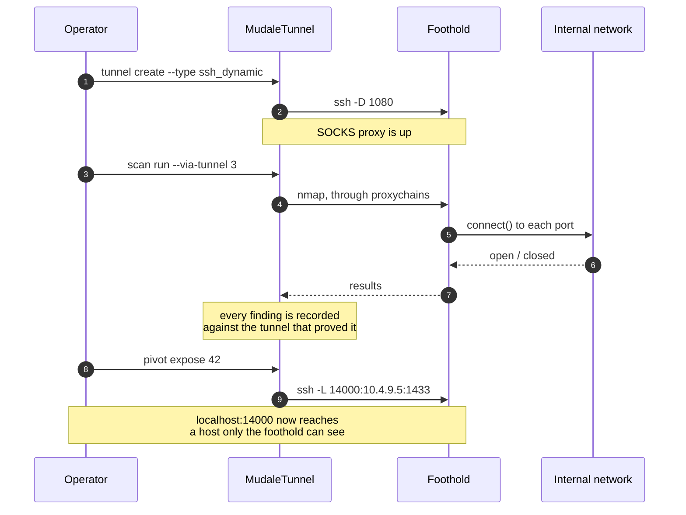
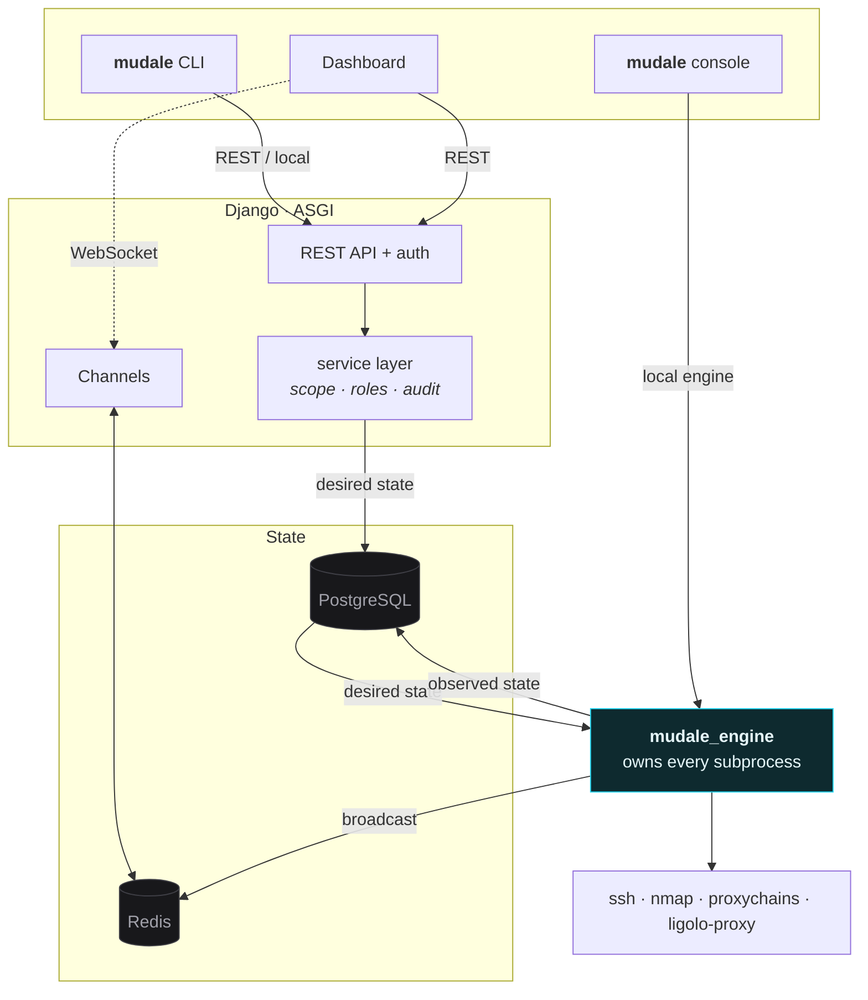
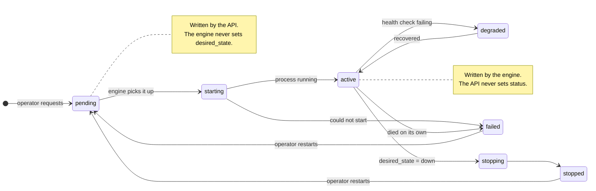
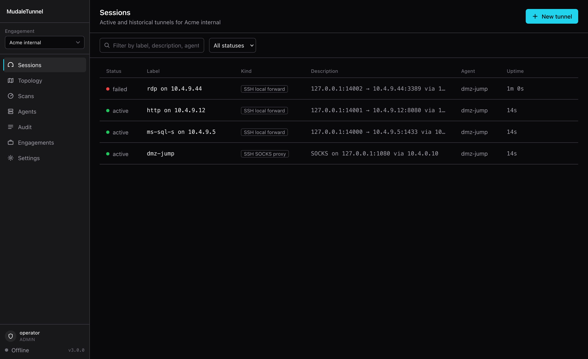
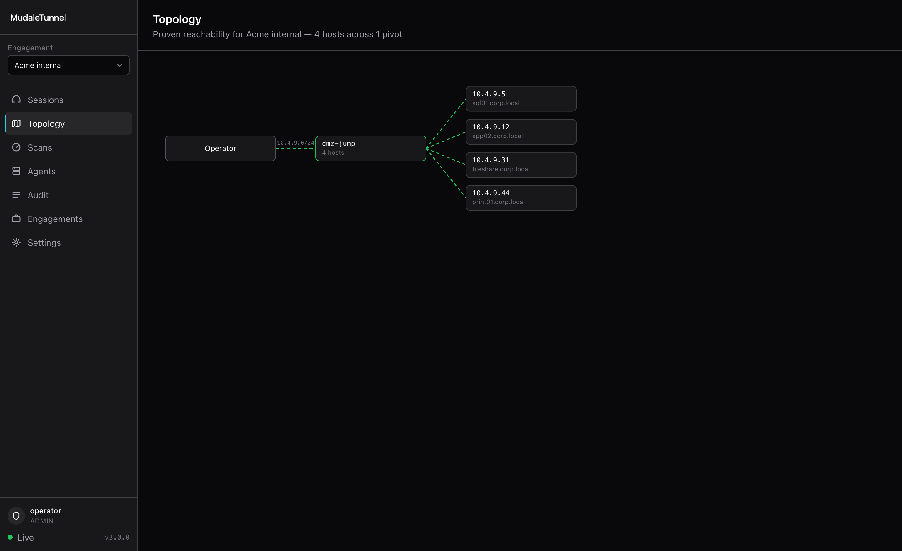
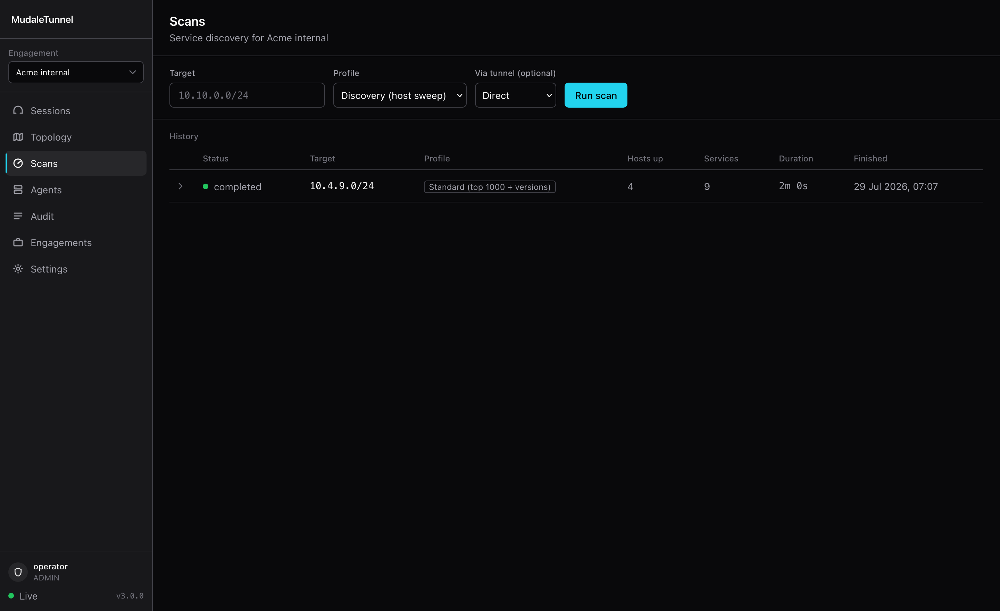
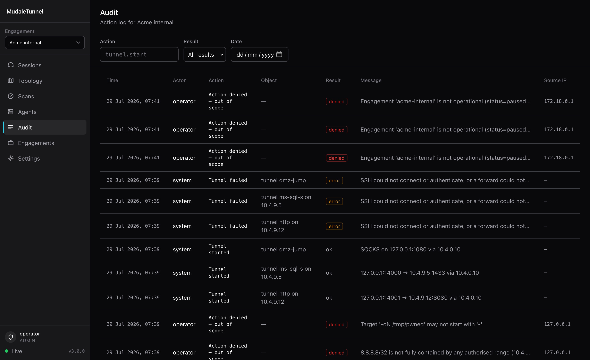

<p align="center">
  
</p>

<h3 align="center">A control plane for network pivoting.</h3>

<p align="center">
  Manages SSH tunnels, network discovery and audit across a penetration-testing engagement — from a standalone CLI, an interactive console, or a web dashboard that share one engine.
</p>

<p align="center">
  <a href="https://github.com/TarzEH/MudaleTunnel/actions/workflows/ci.yml"></a>
  <a href="https://github.com/TarzEH/MudaleTunnel/releases/latest"></a>
  
  
  
  <a href="LICENSE"></a>
</p>

<p align="center">
  <a href="#quick-start">Quick Start</a> &bull;
  <a href="#features">Features</a> &bull;
  <a href="#architecture">Architecture</a> &bull;
  <a href="#using-it">Usage</a> &bull;
  <a href="#security-model">Security</a> &bull;
  <a href="#development">Development</a> &bull;
  <a href="#credits--attribution">Credits</a>
</p>

---

## Demo

<p align="center">
  
</p>

<p align="center">
  <em>Real commands, invented data — every address in the recording is fiction.</em>
</p>

---

## What Problem This Solves

Pivoting tools are good at *moving packets*. The hard part is knowing what is
actually on the other side, keeping track of it, and being able to prove
afterwards what you touched.

MudaleTunnel does pivoting the other way round. Instead of routing a subnet you
*hope* is there into a virtual interface, it:

1. **Reaches** — opens a SOCKS proxy through a foothold (`ssh -D`).
2. **Discovers** — runs nmap *through* that proxy, genuinely proxied. Every open
   port it finds is a host the pivot can reach, recorded against the tunnel it
   was seen through.
3. **Exposes** — turns any finding into a plain local port-forward (`ssh -L`),
   so tools that cannot speak SOCKS get a `localhost` port.
4. **Chains** — a newly reachable host can become the next foothold.



The map is evidence, not assumption.

---

## Features

| | |
|---|---|
| **Engagement scope** | An explicit CIDR allowlist per engagement, enforced in code on every scan, tunnel and route. Nothing outside it can be touched. |
| **Three interfaces** | Standalone CLI (`mudale scan run`, `mudale tunnel create`), interactive console (`mudale console` — msfconsole-style `use/set/run`), and a web dashboard. All share the same engine. |
| **Durable state** | PostgreSQL (server mode) or SQLite (standalone mode). Tunnels, scans, findings and the audit trail survive a restart of any component. |
| **Append-only audit** | Who did what, when — and what was *refused*. Survives operator deletion. |
| **Multiple operators** | Real accounts, roles, per-engagement membership. |
| **CLI↔Dashboard sync** | A tunnel opened in the terminal appears in the browser immediately. The sync bridge validates specs and records audit events. |
| **Process supervision** | The engine owns every child process. SIGTERM → wait → SIGKILL escalation. PID tracking across daemon restarts. No strays. |
| **Hardened specs** | Every tunnel spec passes through frozen Pydantic models. Unknown fields are rejected. Hosts, ports, and usernames are sanitized before any command is built. |

### Tunnel Kinds

| Kind | Tool | Use for |
|---|---|---|
| `ssh_local` | SSH `-L` | Reach one remote service locally |
| `ssh_dynamic` | SSH `-D` | SOCKS proxy into the remote network |
| `ssh_remote` | SSH `-R` | Expose a local service to the remote side |
| `ssh_remote_dynamic` | SSH `-R` (SOCKS) | Reverse SOCKS; needs OpenSSH 7.6+ on both ends |
| `ligolo` | ligolo-ng | Full IP-layer pivoting (TCP/UDP/ICMP) via TUN interface |

### Scan Profiles

Operators pick a profile; raw nmap flags are never accepted.

| Profile | What it does |
|---|---|
| `discovery` | Host sweep, no port scan |
| `quick` | Top 100 ports |
| `standard` | Top 1000 ports with version detection |
| `full` | All 65535 TCP ports with version detection |
| `udp_top` | Top 100 UDP ports (needs root on the engine host) |

All default profiles use `connect()` scans, so they work unprivileged and
through a pivot. No profile can write to a path or run NSE scripts.

---

## Architecture

```
┌─────────────────────────────────────────────────────────┐
│                     Interfaces                          │
│  ┌──────────┐  ┌──────────────┐  ┌───────────────────┐ │
│  │ mudale   │  │ mudale       │  │ Web Dashboard     │ │
│  │ CLI      │  │ console      │  │ (React + WS)      │ │
│  └────┬─────┘  └──────┬───────┘  └─────────┬─────────┘ │
│       │               │                    │            │
│       ▼               ▼                    ▼            │
│  ┌─────────────────────────────────────────────────┐    │
│  │              mudale_engine (shared)              │    │
│  │  specs.py · adapters/ · process.py · enums.py   │    │
│  └───────────────────┬─────────────────────────────┘    │
│                      │                                  │
│       ┌──────────────┼──────────────┐                   │
│       ▼              ▼              ▼                    │
│   SSH / ligolo  Nmap binary    SQLite / PostgreSQL       │
└─────────────────────────────────────────────────────────┘
```



**The web tier never spawns a process.** It records what an operator *wants*;
the engine daemon reconciles reality towards it and writes back what *is*.

**`mudale_engine`** is the shared package used by all three interfaces:
- **Spec validation** — Frozen Pydantic models. `extra="forbid"` rejects unknown fields.
- **SSH adapter** — Uses `-l user host` format (not `user@host`) to prevent scope-ID smuggling through the `@` separator.
- **ligolo-ng adapter** — Manages the `ligolo-proxy` binary for TUN-based pivoting (TCP/UDP/ICMP).
- **Nmap adapter** — Profile-specific flags, proxychains config for tunneled scans, hardened XML output parsing.
- **Process supervisor** — SIGTERM → wait → SIGKILL escalation. PID tracking survives daemon restarts.



Full detail, including process ownership and adoption:
[`docs/architecture.md`](docs/architecture.md).

---

## Quick Start

### Option A: Standalone CLI (no server needed)

```bash
pip install ./backend
mudale --help
```

Scan a target:

```bash
mudale scan run --target 10.4.9.0/24 --profile quick
```

Create a tunnel:

```bash
mudale tunnel create --type ssh_local \
  --rhost 10.4.0.10 --username opsec \
  --lport 1433 --target-host 10.4.9.5 --target-port 1433
```

Interactive console (msfconsole-style):

```bash
mudale console
```

```
  ╔╦╗╦ ╦╔╦╗╔═╗╦  ╔═╗
  ║║║║ ║ ║║╠═╣║  ║╣
  ╩ ╩╚═╝═╩╝╩ ╩╩═╝╚═╝  v3.1.0
   [ SSH tunnels • nmap scanning • network pivoting ]
   7 modules | 0 active tunnels | 0 running scans | engine: ready

mudale > use scan/nmap
mudale scan(nmap) > set TARGET 10.4.9.0/24
mudale scan(nmap) > set PROFILE standard
mudale scan(nmap) > run
```

### Option B: Full Stack (CLI + Dashboard + Multi-operator)

```bash
git clone https://github.com/TarzEH/MudaleTunnel.git
cd MudaleTunnel
cp backend/.env.example .env
```

Generate a secret key:

```bash
python3 -c "import secrets; print(secrets.token_urlsafe(64))"
```

Set `MUDALE_SECRET_KEY` and `MUDALE_DB_PASSWORD` in `.env`, then:

```bash
docker compose up -d --build
docker compose exec web python manage.py createsuperuser
```

The dashboard is on <http://127.0.0.1:8000>. It binds to loopback on purpose —
this is a console that opens tunnels into client networks, so exposing it more
widely should be a deliberate act behind a TLS proxy.

For the CLI in server mode, issue yourself an API key from **Settings → API keys**:

```bash
pip install ./backend
mudale remote login --url http://127.0.0.1:8000 --token mdlt_...
```

### Pre-built Binaries

GitHub Releases includes standalone binaries for Linux (amd64), macOS (arm64),
and Windows (amd64). No Python installation required:

```bash
# Download from https://github.com/TarzEH/MudaleTunnel/releases/latest
chmod +x mudale-darwin-arm64
./mudale-darwin-arm64 --help
```

---

## Using It

### Standalone CLI — discover and pivot

The CLI works out of the box with no server. It keeps state in a local SQLite
database and supervises processes directly.

**1. Scan a target:**

```bash
mudale scan run --target 10.4.9.0/24 --profile quick
```

```
4 hosts up, 12 services found

HOST       PORT       SERVICE       PRODUCT               VERSION
10.4.9.5   22/tcp     ssh           OpenSSH               8.9p1
10.4.9.5   1433/tcp   ms-sql-s      Microsoft SQL Server  15.00.2000
10.4.9.12  445/tcp    microsoft-ds
```

**2. Create a tunnel to reach something behind a foothold:**

```bash
mudale tunnel create --type ssh_local \
  --rhost 10.4.0.10 --username opsec --identity /keys/acme.pem \
  --lport 1433 --target-host 10.4.9.5 --target-port 1433 \
  --label "sql via jump"
```

**3. Open a SOCKS proxy and scan through it:**

```bash
mudale tunnel create --type ssh_dynamic \
  --rhost 10.4.0.10 --username opsec \
  --lport 1080

mudale scan run --target 10.4.50.0/24 --profile standard --via-tunnel 1
```

**4. Check what is running:**

```bash
mudale jobs       # active tunnels
mudale services   # discovered services
mudale kill 1     # stop a tunnel
```

### Interactive Console

The console gives an msfconsole-style workflow with tab-completion:

```bash
mudale console
```

```
mudale > use tunnel/ssh_dynamic
mudale tunnel(ssh_dynamic) > set RHOST 10.4.0.10
mudale tunnel(ssh_dynamic) > set USERNAME opsec
mudale tunnel(ssh_dynamic) > set LPORT 1080
mudale tunnel(ssh_dynamic) > run
mudale > use scan/nmap
mudale scan(nmap) > set TARGET 10.4.50.0/24
mudale scan(nmap) > set VIA_TUNNEL 1
mudale scan(nmap) > run
mudale > show services
```

### Server Mode — multi-operator with dashboard

In server mode, engagements enforce a CIDR allowlist — every target is checked
against the engagement's scope. Create engagements and manage scope from the
dashboard, then connect your CLI:

```bash
mudale remote login --url http://127.0.0.1:8000 --token mdlt_...
mudale remote tunnels   # list tunnels on server
mudale remote scans     # list scans on server
mudale remote status    # check server health
```

**Out of scope is out of scope** (server mode):

```console
$ error  8.8.8.8/32 is not fully contained by any authorised range (10.4.0.0/16, 192.168.50.0/24)
$ error  10.0.0.0/8 is not fully contained by any authorised range (10.4.0.0/16, 192.168.50.0/24)
```

A `/16` allowance does **not** permit scanning the enclosing `/8`, even though
they overlap. Partial overlap fails closed.

### Pivoting in the Dashboard

The dashboard exposes the same pivot workflow through its UI:
- **Pivot map** — what is reachable, and through which tunnel.
- **Expose** — turn any finding into a `localhost` port.
- **Auto-expose** — forward everything a pivot found, bounded by default
  (skips ports 22, 3389, 5985, 623 unless you ask; caps how many forwards
  can be opened at once).
- **Proxychains config** — download a ready-to-use config for tools that speak
  SOCKS.

---

## The Dashboard

Everything the CLI does, the dashboard does — same API, same policy checks. Both
are live: an action taken in the terminal appears in the browser without a
reload.

> The screenshots below use invented data. Every address, hostname and finding
> is fiction, written by `manage.py seed_sample_data`.

**Sessions** — every tunnel in the engagement, what it forwards, and how long it
has been up. Status is observed by the engine, never asserted by the web tier.

<p align="center">
  
</p>

**Topology** — what each pivot has been *proven* to reach. Solid edges are
direct, dashed ones go through a foothold, and each is labelled with the subnets
it opened. Clicking a host offers to expose any of its open ports.

<p align="center">
  
</p>

**Scans** — results grouped by host, with the tunnel each was found through.

<p align="center">
  
</p>

**Audit** — who did what, when, and what was refused. Append-only.

<p align="center">
  
</p>

---

## CLI Reference

### Commands

```
mudale                              Interactive console (default)
mudale console                      Same — msfconsole-style interface
mudale tunnel create [options]      Create and start a tunnel
mudale scan run [options]           Run an nmap scan
mudale jobs                         List active tunnels and scans
mudale services                     List discovered services
mudale kill <id>                    Stop a tunnel by ID
mudale daemon start|stop|status     Manage the background daemon
mudale server [--port 8000]         Start the web dashboard (needs server extras)
mudale remote login --token ...     Connect CLI to a remote MudaleTunnel server
mudale remote tunnels               List tunnels on remote server
mudale remote scans                 List scans on remote server
```

### `mudale tunnel create`

```
--type, -t       (required) ssh_local | ssh_dynamic | ssh_remote | ssh_remote_dynamic | ligolo
--rhost          (required) Target SSH host
--rport          SSH port (default: 22)
--username, -u   SSH username (default: root)
--identity, -i   Path to SSH private key
--insecure       Accept unknown host keys (lab/CTF only)
--lhost          Local bind address (default: 127.0.0.1)
--lport          Local port to listen on
--target-host    Remote target host (local/remote forward)
--target-port    Remote target port
--remote-bind    Remote bind address (reverse tunnels, default: 127.0.0.1)
--remote-port    Remote listen port (reverse tunnels)
--tun-name       TUN interface name (ligolo only, default: ligolo)
--no-selfcert    Disable self-signed certificate (ligolo only)
--label          Human-readable label
```

**Examples:**

```bash
# Local forward — reach a remote MySQL locally
mudale tunnel create --type ssh_local \
  --rhost 10.4.0.10 --username opsec --identity /keys/eng.pem \
  --lport 13306 --target-host 10.4.9.5 --target-port 3306

# SOCKS proxy — route any tool through the foothold
mudale tunnel create --type ssh_dynamic \
  --rhost 10.4.0.10 --username opsec \
  --lport 1080

# Reverse forward — expose your local listener on the remote host
mudale tunnel create --type ssh_remote \
  --rhost 10.4.0.10 --username opsec \
  --remote-port 9000 --target-host 127.0.0.1 --target-port 8000

# ligolo-ng — full IP-layer pivoting via TUN interface
mudale tunnel create --type ligolo \
  --rhost 10.4.0.10 --lport 11601
```

### `mudale scan run`

```
--target         (required) Target IP or CIDR
--profile        discovery | quick | standard (default) | full | udp_top
--via-tunnel     Route scan through an active SOCKS tunnel by ID
```

**Examples:**

```bash
mudale scan run --target 10.4.9.0/24 --profile quick
mudale scan run --target 10.4.50.0/24 --profile standard --via-tunnel 3
mudale services   # see what was found
```

### Interactive Console

```bash
mudale console    # or just: mudale
```

```
  ╔╦╗╦ ╦╔╦╗╔═╗╦  ╔═╗
  ║║║║ ║ ║║╠═╣║  ║╣
  ╩ ╩╚═╝═╩╝╩ ╩╩═╝╚═╝  v3.1.0
   [ SSH tunnels • nmap scanning • network pivoting ]
   7 modules | 0 active tunnels | 0 running scans | engine: ready

mudale > help
mudale > show modules
mudale > use scan/nmap
mudale scan(nmap) > show options
mudale scan(nmap) > set TARGET 10.4.9.0/24
mudale scan(nmap) > set PROFILE standard
mudale scan(nmap) > run
mudale > show services
mudale > use tunnel/ssh_dynamic
mudale tunnel(ssh_dynamic) > set RHOST 10.4.0.10
mudale tunnel(ssh_dynamic) > set USERNAME opsec
mudale tunnel(ssh_dynamic) > set LPORT 1080
mudale tunnel(ssh_dynamic) > run
mudale > jobs
mudale > kill 1
```

Available modules: `scan/nmap`, `tunnel/ssh_local`, `tunnel/ssh_dynamic`,
`tunnel/ssh_remote`, `tunnel/ssh_remote_dynamic`, `tunnel/ligolo`, `pivot/auto`.

---

## Security Model

The full model is in [`docs/security.md`](docs/security.md). In short:

- **Scope is enforced in code, not by convention.** Targets are parsed into
  `ipaddress` objects and the command line is rebuilt *from those objects*, so a
  string that is not an address or network can never reach an argv.
- **Spec validation via Pydantic.** `extra="forbid"` rejects unknown fields.
  SSH uses `-l user host` (not `user@host`) to block scope-ID smuggling.
- **Authentication everywhere.** Sessions or hashed API keys; DRF defaults to
  `IsAuthenticated`; WebSockets are authorised per engagement on connect.
- **Cross-engagement isolation** is enforced on the queryset, not by trusting an
  id in the URL.
- **The audit trail is append-only**, records denials, and names the actor.
- **Redirect safety.** The CLI strips `Authorization` headers on cross-origin
  redirects and validates that pagination URLs stay on the original server.
- **Hardened XML parsing.** Nmap output is parsed with `defusedxml` because
  service banners come from the target.
- **State directories** are created with `mode=0o700`.

To report a vulnerability, see [`SECURITY.md`](SECURITY.md).

---

## Development

```bash
# Backing services only; the app runs on the host
docker compose -f docker-compose.dev.yml up -d

cd backend
uv venv && uv pip install -e ".[dev]"
export MUDALE_SECRET_KEY=dev-only MUDALE_DB_PASSWORD=mudale-dev-password
python manage.py migrate
python manage.py runserver     # terminal 1
python manage.py enginectl     # terminal 2

cd ../frontend
npm install && npm run dev     # terminal 3, proxies /api to :8000
```

### Tests & Linting

```bash
cd backend  && pytest -q && ruff check .
cd frontend && npx tsc --noEmit && npm run build
```

### Project Layout

```
MudaleTunnel/
├── backend/
│   ├── apps/               # Django apps (accounts, api, audit, engagements,
│   │                       #   engine, scans, tunnels)
│   ├── mudale/             # Django project settings
│   ├── mudale_cli/         # Standalone CLI (scan, tunnel, login, console)
│   ├── mudale_console/     # Interactive console (msfconsole-style)
│   ├── mudale_core/        # Standalone engine (state, supervisor, sync, modules)
│   ├── mudale_engine/      # Shared package (specs, adapters, process, enums)
│   └── tests/              # Integration tests
├── frontend/               # React + TypeScript dashboard
│   └── src/
│       ├── pages/          # Engagements, Sessions, Topology
│       ├── components/     # Sidebar, TunnelForm, CommandPalette
│       └── hooks/          # WebSocket, API hooks
├── docs/                   # Architecture, security, development guides
├── docker-compose.yml      # Production stack
├── docker-compose.dev.yml  # Dev backing services
├── Makefile                # Common shortcuts
└── .github/workflows/      # CI + tag-driven releases
```

Layout and conventions: [`docs/development.md`](docs/development.md).

---

## Status

**Working:** SSH tunnels (all four kinds), ligolo-ng TUN tunnels, nmap discovery
directly or through a pivot, engagement scoping, the audit trail, the dashboard,
the CLI, the interactive console, multi-operator access, and CLI↔Dashboard sync.

**Known limits, stated plainly:**

- SSH SOCKS carries **TCP only**. No UDP, no ICMP — `ping` will not traverse an
  SSH pivot. ligolo-ng tunnels carry the full IP layer (TCP/UDP/ICMP) but need
  an agent binary on the target and root on the operator machine.
- Scanning through a pivot needs `proxychains4` on the engine host. It is in the
  Docker image; the dashboard reports `pivot_scanning` as unavailable if it is
  missing, rather than quietly scanning from the wrong vantage point.
- nmap runs unprivileged, so scans are `connect()` scans with `-Pn`. No SYN
  scanning, no OS detection.

---

## Credits & Attribution

### Built With

| Component | Purpose |
|-----------|---------|
| [Django](https://www.djangoproject.com/) 5.2 | Web framework, ORM, auth |
| [Django REST Framework](https://www.django-rest-framework.org/) | REST API |
| [Django Channels](https://channels.readthedocs.io/) | WebSocket for live updates |
| [Pydantic](https://docs.pydantic.dev/) 2.x | Spec validation (tunnel & scan specs) |
| [defusedxml](https://github.com/tiran/defusedxml) | Hardened nmap XML parsing |
| [prompt_toolkit](https://python-prompt-toolkit.readthedocs.io/) | Interactive console |
| [React](https://react.dev/) 18 | Dashboard frontend |
| [Vite](https://vitejs.dev/) | Frontend build tooling |
| [PostgreSQL](https://www.postgresql.org/) | Server-mode state & audit |
| [Redis](https://redis.io/) | WebSocket channel layer |
| [PyInstaller](https://pyinstaller.org/) | Standalone binary builds |

### External Tools (runtime dependencies, not bundled)

| Tool | Author | Purpose |
|------|--------|---------|
| [OpenSSH](https://www.openssh.com/) | OpenBSD Project | SSH tunnel subprocess |
| [Nmap](https://nmap.org/) | Gordon Lyon (Fyodor) | Network scanning |
| [proxychains-ng](https://github.com/rofl0r/proxychains-ng) | rofl0r | SOCKS-proxied scans |
| [ligolo-ng](https://github.com/nicocha30/ligolo-ng) | Nicolas Chatelain | TUN-based pivoting |

---

## Responsible Use & Legal Disclaimer

> **This tool is intended for authorised security testing only.**

MudaleTunnel opens network access into infrastructure. The scope allowlist
exists to keep you inside what a client actually agreed to. It is a safety
rail, not permission.

**You are responsible for:**
- Obtaining explicit written authorisation before testing any network or system
- Complying with all applicable laws and regulations in your jurisdiction
- Operating within the scope defined in your engagement agreement
- Handling any data encountered during testing in accordance with applicable
  privacy regulations

**The authors and contributors:**
- Provide this software "as is" under the MIT license
- Accept no liability for misuse, damage, or legal consequences arising from
  use of this tool
- Do not endorse or authorise any illegal activity

If you discover a security vulnerability in MudaleTunnel itself, please report
it responsibly via [`SECURITY.md`](SECURITY.md).

---

## Licence

MIT — see [LICENSE](LICENSE).
