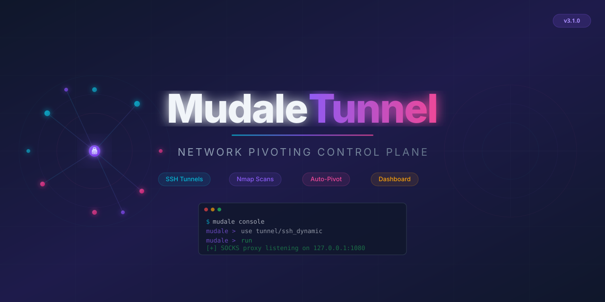

<p align="center">
  
</p>

<p align="center">
  <strong>A control plane for network pivoting.</strong><br>
  Manages SSH tunnels and network discovery across an engagement, from a CLI and a web dashboard that share one API.
</p>

<p align="center">
  
</p>

<p align="center">
  <em>Real commands, invented data — every address in the recording is fiction.</em>
</p>

<p align="center">
  <a href="#quick-start">Quick start</a> &bull;
  <a href="#using-it">Using it</a> &bull;
  <a href="#architecture">Architecture</a> &bull;
  <a href="#security">Security</a> &bull;
  <a href="#development">Development</a> &bull;
  <a href="#status">Status</a>
</p>

---

## What this is

Pivoting tools are good at *moving packets*. The hard part is knowing what is
actually on the other side, keeping track of it, and being able to prove
afterwards what you touched.

MudaleTunnel does pivoting the other way round. Instead of routing a subnet you
*hope* is there into a virtual interface, it:

1. **Reaches** — opens a SOCKS proxy through a foothold (`ssh -D`).
2. **Discovers** — runs nmap *through* that proxy, genuinely proxied. Every open
   port it finds is a host the pivot can reach, recorded against the tunnel it
   was seen through.
3. **Exposes** — turns any finding into a plain local port-forward (`ssh -L`),
   so tools that cannot speak SOCKS get a `localhost` port.
4. **Chains** — a newly reachable host can become the next foothold.

The map is evidence, not assumption. And around that:

| | |
|---|---|
| **Engagement scope** | An explicit CIDR allowlist per engagement, enforced in code on every scan, tunnel and route. Nothing outside it can be touched. |
| **Durable state** | PostgreSQL. Tunnels, scans, findings and the audit trail survive a restart of any component. |
| **Append-only audit** | Who did what, when — and what was *refused*. Survives operator deletion. |
| **Multiple operators** | Real accounts, roles, per-engagement membership. |
| **One API, two clients** | The CLI and the dashboard make the same calls. A tunnel opened in the terminal appears in the browser immediately. |

> **Authorised testing only.** This tool opens network access into other
> people's infrastructure. The scope allowlist exists to keep you inside what a
> client actually agreed to. It is a safety rail, not permission.

---

## Quick start

```bash
git clone https://github.com/TarzEH/MudaleTunnel.git
cd MudaleTunnel
cp backend/.env.example .env
```

Set `MUDALE_SECRET_KEY` and `MUDALE_DB_PASSWORD` in `.env`:

```bash
python3 -c "import secrets; print(secrets.token_urlsafe(64))"
```

Bring it up:

```bash
docker compose up -d --build
```

Create your first operator:

```bash
docker compose exec web python manage.py createsuperuser
```

The dashboard is on <http://127.0.0.1:8000>. It binds to loopback on purpose —
this is a console that opens tunnels into client networks, so exposing it more
widely should be a deliberate act behind a TLS proxy.

For the CLI, issue yourself a key from **Settings → API keys** in the dashboard,
then:

```bash
pip install ./backend
mudale login --url http://127.0.0.1:8000 --token mdlt_...
```

---

## Using it

### 1. Define the engagement

Everything hangs off an engagement, and a new one is **inert**: with no
authorised CIDRs, every target is out of scope until you say otherwise.

```bash
mudale engagement create --name "Acme internal" --client Acme \
  --cidr 10.4.0.0/16 --cidr 192.168.50.0/24
```

### 2. Discover

```bash
mudale scan run --engagement 1 --target 10.4.9.0/24 --profile quick --wait
```

```
12 services on 4 hosts in 34s

HOST       PORT      STATE   SERVICE       VERSION
10.4.9.5   22/tcp    open    ssh           OpenSSH 8.9p1
10.4.9.5   1433/tcp  open    ms-sql-s      Microsoft SQL Server 15.00.2000
10.4.9.12  445/tcp   open    microsoft-ds
```

### 3. Pivot

```bash
mudale tunnel create --engagement 1 --kind ssh_local \
  --ssh-user opsec --ssh-host 10.4.0.10 --identity-file /keys/acme.pem \
  --local-port 1433 --target-host 10.4.9.5 --target-port 1433 \
  --label "sql via jump"
```

The web tier records the request; the engine brings it up and reports back.
Watch it from either side:

```bash
mudale tunnels
mudale tunnel logs 3 --follow
```

### 4. Scan through the pivot

```bash
mudale scan run --engagement 1 --target 10.4.50.0/24 --via-tunnel 3 --wait
```

### Out of scope is out of scope

```console
$ mudale scan run --engagement 1 --target 8.8.8.8 --profile quick
error  8.8.8.8/32 is not fully contained by any authorised range (10.4.0.0/16, 192.168.50.0/24)

$ mudale scan run --engagement 1 --target 10.0.0.0/8 --profile quick
error  10.0.0.0/8 is not fully contained by any authorised range (10.4.0.0/16, 192.168.50.0/24)
```

The second one matters: a `/16` allowance does **not** permit scanning the
enclosing `/8`, even though they overlap. Partial overlap fails closed.

### Turn a finding into a local port

Scanning through a pivot is only half of it. The other half is acting on what
it found:

```bash
mudale pivot map --engagement 1          # what is reachable, and through what
mudale pivot expose 42                   # one finding  -> a localhost port
mudale pivot auto 3                       # everything it found -> forwards
mudale pivot proxychains 3 -o mudale.conf # config for tools that speak SOCKS
```

`pivot auto` is deliberately bounded: it skips 22, 3389, 5985 and 623 unless you
ask for them, and caps how many forwards it will open. One command should not be
able to open a hundred ports into a client network by accident.

```bash
proxychains4 -f mudale.conf nmap -sT -Pn 10.4.50.0/24
```

`-sT -Pn` is not optional through a SOCKS proxy: it carries TCP connections, so
a SYN scan cannot work and nmap's host discovery has nothing to probe with. The
generated config says so, because it is the step everyone gets wrong.

### Tunnel kinds

| Kind | `ssh` equivalent | Use for |
|---|---|---|
| `ssh_local` | `-L` | Reach one remote service locally |
| `ssh_dynamic` | `-D` | SOCKS proxy into the remote network |
| `ssh_remote` | `-R` | Expose a local service to the remote side |
| `ssh_remote_dynamic` | `-R` (SOCKS) | Reverse SOCKS; needs OpenSSH 7.6+ on both ends |

### Scan profiles

Operators pick a profile; raw nmap flags are never accepted.

| Profile | What it does |
|---|---|
| `discovery` | Host sweep, no port scan |
| `quick` | Top 100 ports |
| `standard` | Top 1000 ports with version detection |
| `full` | All 65535 TCP ports with version detection |
| `udp_top` | Top 100 UDP ports (needs root on the engine host) |

All default profiles use `connect()` scans, so they work unprivileged and
through a pivot. No profile can write to a path or run NSE scripts.

---

## Architecture

```
┌──────────────┐        ┌──────────────┐
│  mudale CLI  │        │  Dashboard   │
└──────┬───────┘        └──────┬───────┘
       │   REST + WebSocket    │
       └───────────┬───────────┘
                   ▼
        ┌──────────────────────┐
        │  Django (ASGI)       │
        │  ├── API + auth      │
        │  ├── service layer   │ ← scope checks, roles, audit
        │  └── Channels        │
        └───────┬──────────────┘
                │  desired state
        ┌───────▼──────────────┐      ┌─────────────┐
        │  PostgreSQL + Redis  │◄─────┤  enginectl  │ ← owns every subprocess
        └──────────────────────┘      └──────┬──────┘
                observed state                │
                                        ssh · nmap
```

**The web tier never spawns a process.** It records what an operator *wants*;
the engine daemon reconciles reality towards it and writes back what *is*.

That split is why the system is survivable. A gunicorn or daphne worker is
recycled on every deploy and under load — a tunnel living inside one would be
killed or orphaned by that. Keeping the daemon separate lets the web tier
restart freely while tunnels stay up, and lets the engine restart and re-adopt
what it finds instead of leaving strays behind.

Full detail, including how process ownership and adoption work:
[`docs/architecture.md`](docs/architecture.md).

---

## Security

The full model is in [`docs/security.md`](docs/security.md). In short:

- **Scope is enforced in code, not by convention.** Targets are parsed into
  `ipaddress` objects and the command line is rebuilt *from those objects*, so a
  string that is not an address or network can never reach an argv.
- **Authentication everywhere.** Sessions or hashed API keys; DRF defaults to
  `IsAuthenticated`; WebSockets are authorised per engagement on connect and are
  receive-only.
- **Cross-engagement isolation** is enforced on the queryset, not by trusting an
  id in the URL.
- **The audit trail is append-only**, records denials, and names the actor.
- **The container runs unprivileged**, and nmap output is parsed with hardened
  XML bindings because service banners come from the target.

To report a vulnerability, see [`SECURITY.md`](SECURITY.md).

---

## Development

```bash
# Backing services only; the app runs on the host
docker compose -f docker-compose.dev.yml up -d

cd backend
uv venv && uv pip install -e ".[dev]"
export MUDALE_SECRET_KEY=dev-only MUDALE_DB_PASSWORD=mudale-dev-password
python manage.py migrate
python manage.py runserver     # terminal 1
python manage.py enginectl     # terminal 2

cd ../frontend
npm install && npm run dev     # terminal 3, proxies /api to :8000
```

```bash
cd backend  && pytest -q && ruff check .
cd frontend && npx tsc --noEmit && npm run build
```

Layout and conventions: [`docs/development.md`](docs/development.md).

---

## Status

**Working:** SSH tunnels (all four kinds), nmap discovery directly or through a
pivot, engagement scoping, the audit trail, the dashboard, the CLI, and
multi-operator access.

**Known limits, stated plainly:**

- SOCKS carries **TCP only**. No UDP, no ICMP — `ping` will not traverse a
  pivot. Tools that build a virtual network interface do carry those; this
  deliberately does not, in exchange for needing no agent and no root.
- Scanning through a pivot needs `proxychains4` on the engine host. It is in the
  Docker image; the dashboard reports `pivot_scanning` as unavailable if it is
  missing, rather than quietly scanning from the wrong vantage point.
- nmap runs unprivileged, so scans are `connect()` scans with `-Pn`. No SYN
  scanning, no OS detection.

Version 3 is a rewrite; versions 1–2 share nothing with it but the name and the
idea. [`docs/architecture.md`](docs/architecture.md) records what changed and
why.

## Licence

MIT — see [LICENSE](LICENSE).
